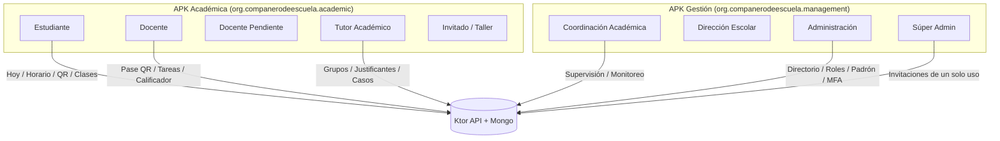

# Auditoría Integral de UX, Perfiles, Privilegios, Acciones y Madurez del Sistema

**Fecha:** 7 de noviembre de 2026  
**Proyecto:** Compañero de Escuela (`apps/android`, `services/api`, `shared`)  
**Base de código analizada:** `main` @ `00b8f2eb`

---

## 1. Resumen Ejecutivo y Diagnóstico de Madurez

Compañero de Escuela ha evolucionado desde una arquitectura de asistencia escolar básica hacia una plataforma integral con dos distribuciones Android independientes (**Académica** y **Gestión**), respaldadas por un backend Ktor reactivo y persistencia en MongoDB con control estricto de ámbito (*scoped authority*).

### Evaluación de Madurez Global

| Dimensión | Nivel | Diagnóstico |
|---|---|---|
| **Seguridad y Autoridad** | **Alta / Robusta** | Principio *Fail closed*, autoridad viva verificada en cada llamada al backend, contraseñas no compartidas, CAS atómico en cambios de rol, paso escalonado MFA (TOTP) obligatorio para operaciones críticas administrativas. |
| **Arquitectura de Navegación** | **Alta / Madura** | `RoleExperienceResolver` gobierna la experiencia según roles concedidos y distribución APK. Las pantallas nunca asumen permisos por sí solas. Separación clara de destinos de primer nivel y rutas secundarias. |
| **Diseño y UX V8/V25** | **Media-Alta** | Paleta borgoña mate `#17191F` con contraste certificado (4.81:1 a 16.56:1), soporte para alto contraste, movimiento reducido, escalado de texto (hasta 200–240%) y adaptación compacta (320 dp). |
| **Integración Institucional (SIII)** | **En Desarrollo / Limitada** | Adaptadores de lectura, proyección y outbox HMAC presentes; sin embargo, la publicación oficial de actas de calificación (`UnavailableGradeSyncGateway`) y la propuesta de horarios oficial (`schedule:propose`) siguen pendientes en el proveedor real. |
| **Resiliencia Offline** | **Alta** | Base de datos Room en el dispositivo para la agenda y outbox de asistencia con WorkManager para conciliación asíncrona. |

---

## 2. Matriz de Perfiles, Privilegios y Distribución

La plataforma implementa un modelo de autorización en capas:
1. **Distribución (`AppDistribution`)**: Delimita qué aplicación puede ejecutar cada experiencia (evita que un alumno acceda a la app de gestión o que un directivo use la app académica sin rol de aula).
2. **Experiencia de Producto (`AppExperience`)**: Configura la barra de navegación inferior, destinos principales y encabezados.
3. **Autoridad de Servidor (`PlatformSessionAuthority` / Scopes)**: Cada endpoint valida la sesión viva, el rol de usuario, la institución y la pertenencia a aula/grupo.

### Detalle por Perfil

| Perfil (`UserRole`) | Distribución | Destino Inicial | Destinos de Primer Nivel | Alcance y Privilegios en Backend |
|---|---|---|---|---|
| **Estudiante** (`STUDENT`) | Académica | `Destination.Home` (Hoy) | Hoy, Horario, Asistencia, Clases | Solo consulta datos propios, escanea QR de asistencia de su clase, entrega tareas privadas en sus clases, consulta sus notas locales y propone jefes de grupo. |
| **Docente** (`TEACHER`) | Académica | `Destination.TeacherHome` (Hoy) | Hoy, Horario, Asistencia, Canal | Genera QR firmado rotativo, realiza pase de lista y revisión manual con CAS, crea y califica tareas (0–10), gestiona ponderaciones en calificador nativo. |
| **Docente Pendiente** (`TEACHER_PENDING`) | Académica | `Destination.TeacherHome` | Solo Hoy (sin herramientas) | Puede ver su estado de espera. Sin acceso a pases, aulas, tareas ni calificaciones hasta aprobación administrativa. |
| **Tutor Académico** (`TUTOR`) | Académica | `Destination.TutorHome` (Tutoría) | Tutoría, Mi grupo, Solicitudes | Acceso delimitado exclusivamente a los grupos asignados por administración. Revisa asistencia, casos confidenciales y justificantes de sus tutorados. |
| **Coordinación** (`COORDINATOR`) | Gestión | `Destination.CoordinatorHome` | Gestión, Horario | Supervisa pases abiertos y revisiones pendientes de toda la institución, verifica cobertura horaria, autoriza justificantes escalados. |
| **Dirección** (`PRINCIPAL`) | Gestión | `Destination.CoordinatorHome` | Gestión, Horario | Supervisión institucional macro. Comparte la superficie de coordinación con identificador de Dirección. |
| **Administración** (`ADMIN`) | Gestión | `Destination.AdminHome` | Gestión, Horario, Clases, Canal | Directorio de usuarios, activación/suspensión de cuentas, aprobación de staff con asignación de grupo, edición interna de horarios y clases con MFA, importación de padrón (CSV/XLSX/PDF). |
| **Súper Admin** (`SUPER_ADMIN`) | Gestión | `Destination.AdminHome` | Gestión, Horario, Clases, Canal | Todas las facultades de Administrador más la emisión de códigos de invitación de un solo uso para incorporación de personal directivo y docente. |
| **Invitado / Taller** (`GUEST`, `WORKSHOP_PARTICIPANT`) | Académica | `Destination.Profile` | Solo Perfil | Acceso básico sin datos escolares. Puede ajustar accesibilidad/apariencia y gestionar su sesión. |

---

## 3. Flujos Operativos y Trabajo Interdisciplinario

### A. Flujo de Asistencia y Pase de Lista
1. **Inicio de sesión por docente**: El docente abre su clase en `AttendanceScreen`; el backend genera un token de sesión con rotación de firma criptográfica HMAC cada pocos segundos.
2. **Escaneo del alumno**: El estudiante escanea el código dinámico con su cámara. Si no hay conexión a internet, el escaneo se guarda en la bandeja de salida local (`Room attendance outbox`) con reintento automático vía `WorkManager`.
3. **Revisión y conciliación**: El docente visualiza el padrón en tiempo real (asistencias automáticas marcadas) y puede aplicar decisiones manuales auditadas (Presente, Falta, Justificado) mediante Compare-And-Swap (CAS).
4. **Supervisión institucional**: Coordinación y Dirección reciben el agregado de pases abiertos y revisiones pendientes en su tablero.

### B. Flujo de Tareas y Evaluación Formativa
1. **Publicación docente**: El docente define una tarea en `ChannelScreen` con título, instrucciones, ponderación porcentual y fecha límite.
2. **Entrega privada**: El alumno entrega archivos privados (almacenados de forma aislada sin acceso entre pares).
3. **Revisión y retroalimentación**: El docente califica de 0 a 10, escribe comentarios y puede requerir reentrega (`REVIEWED` / `REVISION_REQUESTED`).
4. **Calificador nativo**: El docente importa notas o usa el calificador de ponderaciones automáticas.

### C. Flujo de Tutorías y Justificantes
1. **Petición**: El alumno o representante registra una solicitud de justificante ante incidencias de salud o institucionales.
2. **Revisión tutorial**: El tutor del grupo valida la causa dentro de su ámbito estricto (`TutorAssignmentScope`).
3. **Escalamiento y cierre**: Casos que involucran múltiples días o periodos de examen se elevan a Coordinación Académica.

### D. Flujo Administrativo y Seguridad de Segundo Factor
1. **Gestión de cuentas**: Administradores buscan operadores en el directorio.
2. **Paso escalonado (MFA Step-Up)**: Toda operación de riesgo (aprobación de docentes, revocación de roles, alteración de horarios o emisión de invitaciones) exige un reto TOTP verificado en el servidor antes de aplicar el cambio atómico.

---

## 4. Qué les falta y Límite de Maduración (Brechas Reales)

Para alcanzar el estado de producción industrial completa, se identifican las siguientes brechas:

1. **Sincronización Oficial de Calificaciones SIII**:
   - *Estado actual*: La API utiliza `UnavailableGradeSyncGateway`. El calificador nativo calcula notas y almacena revisiones internas, pero no transmite actas oficiales a la base de datos institucional de SIII.
   - *Criterio de cierre*: Implementar el conector autenticado SIII, pruebas E2E de ciclo de actas y reconciliación de discrepancias.
2. **Propuesta y Aprobación Oficial de Horarios**:
   - *Estado actual*: El editor administrativo genera registros con procedencia `ADMIN_MANUAL`. Falta el flujo de propuesta formal (`schedule:propose`) y aceptación firmada en SIII.
3. **Consistencia Atómica en Encolado de Avisos (FCM)**:
   - *Estado actual*: Si ocurre un fallo de red o reinicio entre la persistencia del evento de negocio y el encolado de la notificación en el outbox push, el aviso puede perderse sin reintento permanente.
   - *Criterio de cierre*: Persistir la intención de aviso de forma atómica en la misma transacción o acoplar un reconciliador de eventos huérfanos.
4. **Padrón con Alumnos Heredados de Grupo**:
   - *Estado actual*: `ClassroomService.listMembers` toma en cuenta la membresía directa del aula. En casos donde un grupo entero se matricula en una materia, debe unificarse el conteo sin duplicar registros.
5. **Consola Diferenciada para Dirección**:
   - *Estado actual*: Dirección (`PRINCIPAL`) comparte la interfaz de `CoordinatorHomeScreen`. Aunque la autoridad es correcta, convendría añadir indicadores estratégicos institucionales específicos para la dirección (tasas de aprobación globales, índices de deserción temprana).
6. **Externalización Completa de Textos (I18N)**:
   - *Estado actual*: Múltiples cadenas en pantallas de Canal, Calificaciones y Asistencia permanecen como literales en código Compose en lugar de recursos `strings.xml`.

---

## 5. Hallazgos UX Resueltos en Esta Auditoría

Durante la inspección minuciosa de navegación, componentes y estados de usuario se identificaron y remediaron tres defectos críticos de experiencia:

### 1. Desbloqueo de Rutas no Disponibles (`RoleUnavailableScreen`) — P1 (UX Trap)
- **Problema encontrado**: Cuando un usuario autenticado con un rol válido (ej. Estudiante) navegaba por enlace o pila hacia una sección restringida para su modo activo, la pantalla mostraba el mensaje informativo pero no renderizaba ningún botón interactivo. El usuario quedaba atrapado sin poder regresar ni reintentar.
- **Corrección**: Se incorporó el callback `onBack` con botón primario **"Volver"** que invoca `navController.popBackStack()`, además del botón de cierre de sesión seguro.

### 2. Títulos de Cabecera en Pantallas Secundarias (`secondaryTitleForRoute`) — P2
- **Problema encontrado**: Al navegar a destinos secundarios como `invitation-acceptance`, `invitation-issue`, `role-unavailable`, `coordinator-home` o `admin-home`, el evaluador `secondaryTitle` en `CompaneroScaffold` no los tenía mapeados y mostraba por defecto el texto genérico `"Volver"` en la barra superior.
- **Corrección**: Se implementó y testeó la función exhaustiva `secondaryTitleForRoute(route)`, asignando títulos semánticos adecuados (*"Aceptar invitación"*, *"Enviar invitación"*, *"Acceso no disponible"*, *"Supervisión institucional"*).

### 3. Precisión de Texto y Expectativas en Perfil (`ProfileScreen`) — P2
- **Problema encontrado**:
  - La fila de Horarios anunciaba: *"Edición interna con MFA; publicación en SIII."*, lo cual generaba la falsa expectativa de que el guardado publicaba a SIII.
  - La fila del Sistema Escolar mostraba *"Conectar con SIII"*, sugiriendo erróneamente un flujo de ingreso de credenciales SIII en el teléfono.
- **Corrección**: Se actualizaron los textos a *"Edición interna con MFA de grupos y horarios."* y *"Estado de sincronización institucional"*, alineándolos con la realidad del sistema.

---

## 6. Verificación de Calidad y Pruebas

Se ejecutaron las pruebas unitarias y de formato de los módulos modificados:
- `:apps:android:core:navigation:testDebugUnitTest` (incluye nuevas aserciones para títulos secundarios y navegación de roles).
- `:apps:android:app:testAcademicDebugUnitTest`.
- `:apps:android:app:testManagementDebugUnitTest`.
- `ktlintCheck` en todos los proyectos afectados (`app`, `navigation`, `profile`, `home`, `tutoring`, `api`).

**Resultado:** `BUILD SUCCESSFUL` (0 fallos, 0 errores de estilo).
