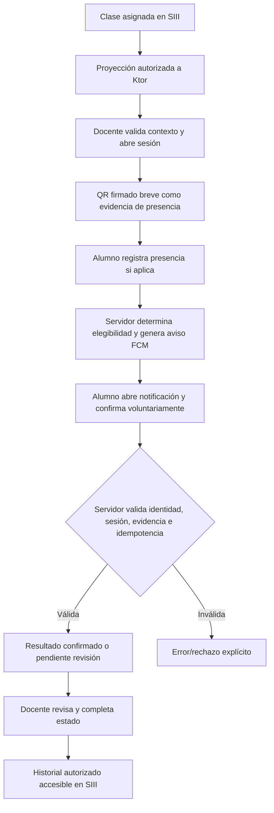

# V25 — Matriz de fidelidad y pruebas para el diseño aprobado

> Complementa [plan maestro](./V25_VISUAL_MASTER_PLAN.md). Cada fase registra capturas de ANTES/DESPUÉS y SHA. El PNG original de 1122 × 1402 debe incorporarse para certificación; [miniatura aprobada](./references/companero-v25-approved-preview.webp) es solo guía en Git.

| ID | Pantalla/rol | Visual de referencia | Fuente real / acción | Prueba mínima |
|---|---|---|---|---|
| UI-01 | Onboarding | Splash blanco, ilustración y progreso discreto | Estado real inicial, icono/branding propio | No loop falso, back y cold-start |
| UI-02 | Estudiante Hoy | Hola + nombre + 9A + UPTlax + avatar + campana | Perfil y claims autorizados, notificaciones reales | Dual role, missing name, denied notice |
| UI-03 | Próxima clase | Hero borgoña prominente con materia/Olaf/10:30/aula | `HomeViewModel` + `TodaySchedule`, autoridad académica | Ninguna clase, hoy, mañana, en curso, revocada |
| UI-04 | Tiles | 4 acciones blancas compactas | Rutas Hoy/Agenda/Clases/Asistencia/Avisos según rol | 360dp, 200% font, tap accesible |
| UI-05 | Esta semana | Filas 2 líneas y chevron | ScheduleEntry institucional/personal con provenance | Sin horarios, duplicado, offline, invalidez |
| UI-06 | Barra | Cápsula carbón con píldora activa | CompaneroBottomBar existente, rutas por AppExperience | Estudiante vs docente vs guest / distros |
| UI-07 | Teacher Hoy | Hero de clase activa + iniciar/revisar | TeacherHomeScreen y AttendanceViewModel | No ownership, sesión cerrada, sin aula |
| UI-08 | QR docente | QR real y estado con timer | Servidor firma/rota; teacher habilitado | 25s TTL, 15s refresh, 403, error cámara |
| UI-09 | Presencia estudiante | Scanner dedicado/permiso y preview | AttendanceQrScanner + evidencia | inválido/expirado/otra clase/offline |
| UI-10 | Un toque estudiante | Hoja inferior + confirmar + estado | FCM/deep-link + endpoint autenticado | duplicated notification, denied FCM, cold-start |
| UI-11 | Revisión docente | Contador auténtico y lista privada | Estado autorizado AttendanceRepository | pending, accepted, rejected, concurrent |
| UI-12 | Historial | Lista legible de sesiones/estados | Compañero + reflejo SIII autorizado | Auditoría sin PII de otros grupos |
| UI-13 | Modo oscuro | Carbón mate con bordes mínimos | Theme.kt + Preference | Sin flash en arranque; AA/High contrast |
| UI-14 | Invitado | Mismas superficies pero acceso limitado | RoleExperienceResolver/AppDistribution | No acceso horario oficial ni asistencia |
| UI-15 | Home sin enlace SIII | Estado vacío/denegado veraz | status 401/403, identity link y snapshots | No fallback engañoso al dato oficial |
| UI-16 | Dispositivos | Layout móvil sin corte | Constraints/WindowBreakpoints | 360,390,430 dp, 200% fonts, teclado |
| UI-17 | Movimiento | selector, sheet, check y estado | CompaneroMotion / reducedMotion | Sin jitter, sin falsa confirmación |
| UI-18 | App Distribuciones | Academic y Management sin cruces | AppDistribution | ambas APK compilan, pruebas UI por distribución |

## Secuencia estricta de pase de lista

Las implementaciones existentes prevalecen si el flujo concreto está más protegido; no se modifica política de presencia en una tarea de UI.

## PRs y gates sugeridos
- PR-UI-A: tokens + navegación; solo componentes núcleo + capturas.
- PR-UI-B: Hoy estudiante; sin cambios API.
- PR-UI-C: Hoy docente y sheet; sin cambios de autorizaciones.
- PR-UI-D: asistencia real y estados UX; pruebas fuerte de sesión/notificación.
- PR-UI-E: agenda, clases, canales, perfil e invitado; limpieza.
- PR-UI-F: regresión visual/accesibilidad/CI + QA sobre cuentas institucionales autorizadas.
- Cada PR: cambios acotados + before/after + qué reusa + qué elimina + capturas + pruebas y SHA. No integrar cambios de diseño sobre #243 sin comparar el diff.

## Evidencia requerida antes de «listo»
- Capturas directas desde Android real o emulador — no únicamente renders IA.
- Prueba con estudiante inscrito y docente asignado + escenario sin datos.
- QR expirado, sesión revocada, push denegado, inicio desde app cerrada y duplicados idempotentes.
- Unit + Ktlint + UI instrumentation API31/API35 + ambas variantes.
- Estado de integración SIII ↔ Ktor ↔ Android documentado y CI final verde.
